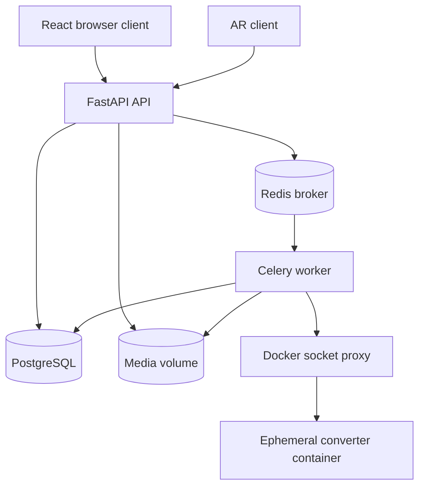

# Architecture

The platform separates HTTP requests from long-running work. FastAPI validates requests and records state in PostgreSQL; it sends background jobs through Redis to Celery workers. Uploaded files and generated artifacts are persisted in the shared media volume.

## Services

- **API:** serves HTTP routes, validates input, authorizes access, and queues jobs.
- **Worker:** executes conversion and thumbnail tasks. The converter image is external to this repository and is configured by `CONVERTER_IMAGE`.
- **Database:** stores users, designs, review records, and classification data.
- **Redis:** brokers Celery jobs and stores task results.
- **Socket proxy:** mediates worker access to the host Docker daemon in the production Compose topology.
- **nginx and frontend builder:** production services serving the built React app and proxying API traffic.

See `fastapi_app/docker-compose.yml` and `fastapi_app/docker-compose.prod.yml` for the authoritative service wiring.

## Code layers

The `fastapi_app/app/` package is organized by responsibility:

| Package | Responsibility |
|---|---|
| `app.main` | FastAPI application, middleware, and route registration |
| `app.api.routes` | HTTP endpoints grouped by feature |
| `app.api.deps` | Authentication and authorization dependencies |
| `app.schemas` | Pydantic request and response types |
| `app.core` | Configuration, security, and upload validation |
| `app.models` | SQLAlchemy entities and domain state |
| `app.db` | Database engines and session factories |
| `app.data` | Data access helpers |
| `app.worker` | Celery setup and background tasks |

## Database sessions

The API uses asynchronous SQLAlchemy sessions while Celery tasks use synchronous sessions. They share the same database but use separate engines and drivers. Routes should use the async session dependency; synchronous worker tasks should use the worker session factory.

## Data model

Users own designs. Designs can have multiple review records over time, preserving submission and decision history. Locarno classification values are stored with designs and resolved through the classification data tables. Refer to the generated [model API](api/models.md) for the current fields and relationships.
