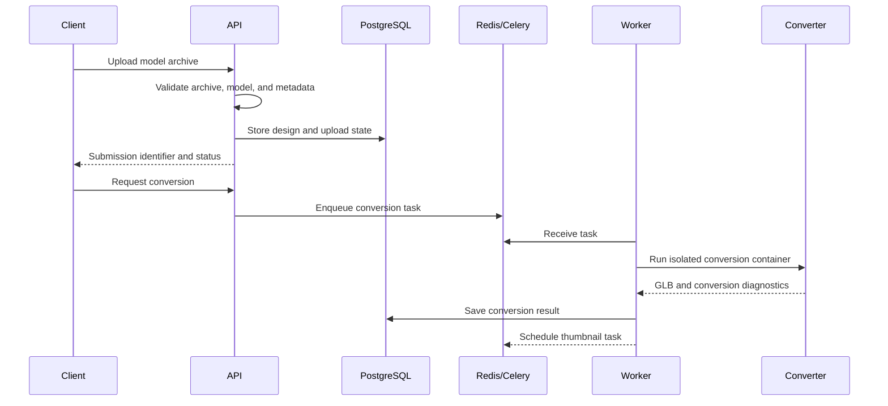
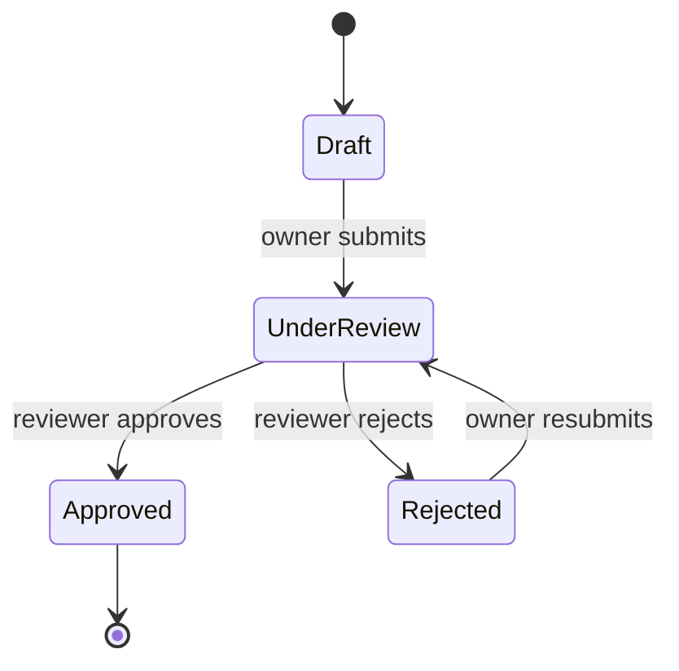

# Request and worker flows

This page summarizes the main asynchronous flows. The exact route schemas and response codes are documented by the running API at `/docs` and in the [route reference](api/routes.md).

## ZIP upload and conversion

Upload validation should reject unsafe ZIP paths, unsupported or mismatched file types, and archives exceeding configured limits. Conversion errors are recorded against the design so clients can report failure and retry where supported.

## Image generation

Where a generator service is configured, reference images are validated and sent through the generation task. The resulting model is passed through the same converter/post-processing path so generated and uploaded models share output handling.

## Review lifecycle

Design review and publication are separate from conversion. A converted model can be submitted for review; an authorized reviewer makes a decision, and public visibility is controlled by the resulting review state. Owners and administrators have different access to private or pending designs. Check the current `ReviewDecision` and route authorization code before changing transitions.

## Media access

Model files and thumbnails are served by the API. Authorization depends on the design’s current review state and the caller’s identity or capability token. Keep media tokens scoped to media access and validate them independently from login tokens.
